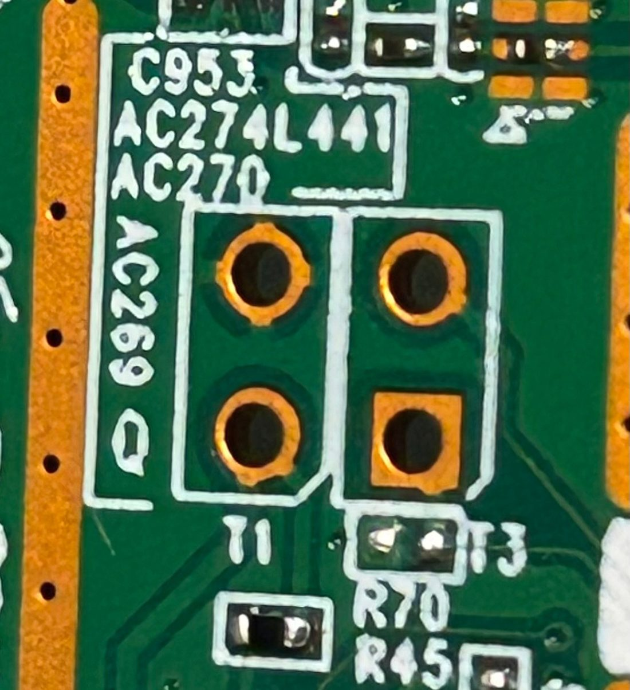
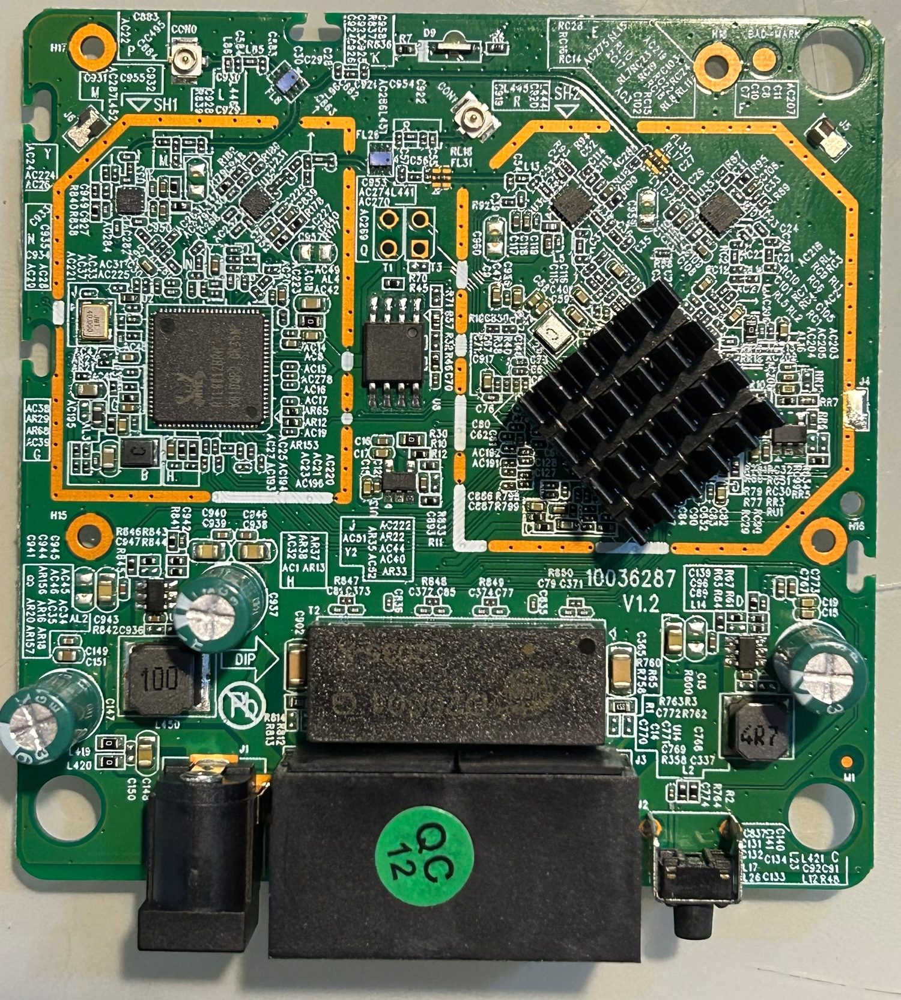
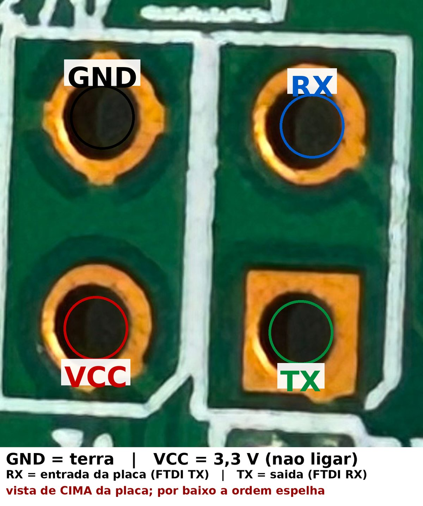
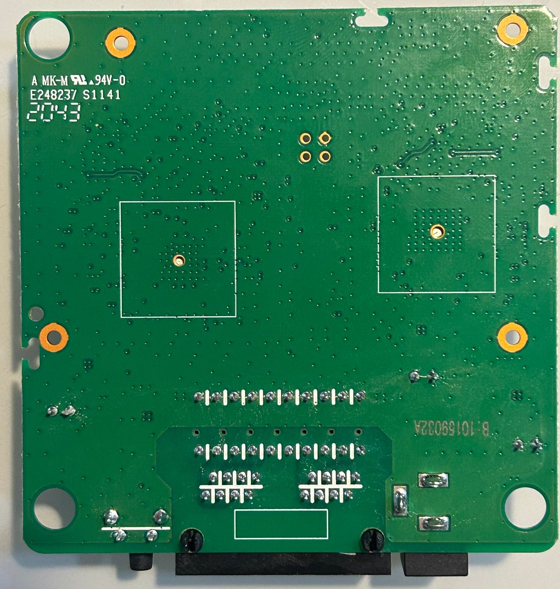

# Intelbras Twibi Fast — engenharia reversa e firmware customizado

Roteador mesh **Intelbras Twibi Fast** (OEM **Tenda**, plataforma **Realtek RTL8197F**):
engenharia reversa do firmware original, recuperação de uma unidade "brickada" e
firmware próprio com SSH, sem nuvem e com controle de internet por faixa de IP.

> ⚠️ Projeto pessoal, educacional, feito **no meu próprio aparelho** (uma unidade de
> sacrifício). Não é afiliado à Intelbras nem à Tenda. Mexer no firmware **anula a
> garantia** e pode inutilizar o aparelho — se for repetir, faça por sua conta e risco.

---

## TL;DR

- O Twibi Fast é um **RTL8197F + RTL8812BRH**, 8 MB de flash, 64 MB de DDR2, Linux 3.10.90.
- Uma unidade parou de bootar (`rootfs checksum error`) — era **rootfs truncado** por
  uma atualização interrompida.
- Recuperei pela **UART** (115200) + **disaster mode** do bootloader + **TFTP**.
- Decifrei o **checksum do rootfs** que o bootloader valida (soma de 16 bits).
- Construí um **firmware próprio** (`chiconws`) mantendo o kernel oficial:
  SSH no lugar do telnet, sem nuvem/TR-069, branding próprio, faixa de IP para IoT com
  internet ligável/desligável, página web e API JSON.

---

## Antes de tudo: o que é UART e o que é o FTDI232

**UART** é a "porta serial" do aparelho — um **console de texto** que existe desde o
primeiro programa (o bootloader), antes de qualquer rede ou sistema operacional. Em vez
de teclado e monitor, você liga **três fios** (GND, TX, RX) a um adaptador no PC e
passa a ver e digitar o que o roteador vê durante o boot. É o que salvou este aparelho:
com a flash corrompida, era o único canal que ainda respondia.

**FTDI232** (chip **FT232RL**) é o **adaptador USB → serial**: de um lado o USB do PC
(aparece como `/dev/ttyUSB0`), do outro três pinos que vão nos pads da placa. É vendido
como "adaptador FTDI FT232RL" (aqueles módulos com jumper **3,3 V / 5 V**). Ele **não**
alimenta a placa: o Twibi usa a própria fonte de 9 V; do adaptador vêm só os sinais.

<p align="center">
  
</p>

| Pad da placa | Sinal | Vai no adaptador |
|---|---|---|
| 1 | GND | GND (ligue **primeiro**) |
| 2 | RX (entrada) | TX do adaptador |
| 3 | VCC 3,3 V | **nada** |
| 4 | TX (saída) | RX do adaptador |

Detalhes: adaptador em **3,3 V**, console em **115200 8N1**, `TX ↔ RX` cruzados e
GND comum. Qualquer terminal serial serve (PuTTY, `picocom`, `minicom`, `screen`) — e
este repo inclui um em Python (`tools/` do projeto completo).

## Glossário rápido

| Termo | O que é |
|---|---|
| **UART** | console serial da placa (texto, 3 fios) |
| **FTDI232** | adaptador USB ↔ serial usado para falar com a UART |
| **TFTP** | protocolo simples de transferência de arquivo (UDP); o bootloader escuta em `192.168.1.6` |
| **Bootloader** | primeiro programa da flash: inicializa a RAM, carrega o kernel e tem o modo de recuperação |
| **uImage** | cabeçalho de 64 bytes que embrulha a imagem do firmware |
| **squashfs** | sistema de arquivos comprimido e somente-leitura usado no rootfs |
| **rootfs** | a "raiz" do Linux: todos os arquivos do firmware |
| **checksum** | soma de verificação que o bootloader usa para validar o rootfs |
| **CFM** | partição de configuração persistente do firmware (chaves `chave=valor`) |

---

## Hardware

| Item | Detalhe |
|---|---|
| SoC | Realtek **RTL8197FNT** — MIPS 24Kc @ 600 MHz, DRAM DDR2 64 MB no pacote |
| 5 GHz | **RTL8812BRH** (802.11ac 2×2) |
| 2.4 GHz | rádio integrado do RTL8197F |
| Flash | 8 MB SPI (BOYAMICRO/BOHONG **BH25Q64**) |
| Ethernet | 2× 100 Mbps (uma porta é WAN/LAN automática) |
| Alimentação | 9 V / 1 A, **centro positivo** |

<p align="center">
  
</p>

Fotos do SoC e do rádio 5 GHz: [`images/soc-rtl8197fnt.jpg`](images/soc-rtl8197fnt.jpg),
[`images/soc-rtl8812brh.jpg`](images/soc-rtl8812brh.jpg).

---

## O aparelho brickado e a recuperação

Sintoma: LED fixo, link de rede ativo mas **RX = 0** (não transmitia), sem DHCP, sem
SSID, botão de reset sem efeito.

Pela UART apareceu a causa:

```
Booting...
DRAM Type: DDR2, 533MHz, Size: 64MB
found BH25Q64, size=8MB
Boot release version:247 (May 11 2018) (600MHz)
wait for upgrage
rootfs checksum error at 0021D012!
<RealTek>
```

O firmware do aparelho estava com o **rootfs truncado** (só ~256 KB de 3,4 MB) — o
bootloader rodava, mas recusava o rootfs e parava no prompt.

### UART

Conector 2×2 na placa. A ordem real (descoberta medindo continuidade e testando):

<p align="center">
  
</p>

| Pad | Sinal |
|---|---|
| 1 | **GND** |
| 2 | **RX** (entrada da placa — vai no TX do adaptador) |
| 3 | **VCC 3,3 V** — **não ligar** |
| 4 | **TX** (saída da placa — vai no RX do adaptador) |

Console em `115200 8N1`. O adaptador deve estar em **3,3 V**; **nunca** conecte o VCC
dele ao pad 3.

### Disaster mode + TFTP (por cabo Ethernet)

Antes de tudo: **a UART é só o console** — é por ela que você vê o boot e digita
comandos. A **imagem do firmware não passa pela UART**: ela é enviada por **cabo de
rede**, usando TFTP (o bootloader sobe um servidor TFTP em `192.168.1.6` e você empurra
o arquivo pelo PC). São dois canais separados: UART para enxergar/diagnosticar, Ethernet
para transferir.

### Disaster mode + TFTP

Segurando o reset **no power-on**, o bootloader entra em modo de recuperação
(`Entry disaster mode`) e sobe um servidor **TFTP em `192.168.1.6`**. Enviando a imagem
com o cabeçalho uImage removido (6.378.516 bytes), ele valida e grava sozinho:

```
Linux kernel (root-fs) upgrade.
checksum Ok !
burn kernel-fs Addr:0x00030000 ...
squashfs upgrade. checksum Ok !
burn rootfs ...
reboot.......
```

Detalhes do procedimento: [`docs/recovery.md`](docs/recovery.md).

---

## O checksum do rootfs (decifrado)

O bootloader valida o rootfs com uma soma simples, descoberta descompilando o segundo
estágio dele:

```
len = bswap32(*(u32 *)(rootfs + 8)) + 0x282;
sum = 0;
for (i = 0; i < len; i += 2)
    sum += bswap16(*(u16 *)(rootfs + i));
if (sum != 0) -> "rootfs checksum error"
```

Ou seja: **soma de 16 bits (big-endian) que tem que dar zero**; os 2 bytes finais são o
complemento. O campo em `squashfs+8` guarda `tamanho_total - 0x282`.

A ferramenta [`tools/mkimage_twibi.py`](tools/mkimage_twibi.py) recalcula isso e produz
uma imagem aceita pelo bootloader — o round-trip com a imagem oficial é byte a byte
idêntico.

---

## Firmware `chiconws`

Firmware próprio montado sobre o rootfs oficial (mesmo kernel, mesma partição), com:

| Recurso | Original | `chiconws` |
|---|---|---|
| Acesso remoto | telnet (texto claro) | **SSH** (dropbear estático) |
| Nuvem Tenda (`ucloud`) | ativo | removido |
| TR-069 (`cwmpd`) | ativo | removido |
| Reboot diário (03:00) | ativo | desligado |
| Hostname / banner / web | Intelbras | `chiconws` |
| Faixa IoT `192.168.6.200-254` | — | internet **ligável/desligável** |
| Página web + API JSON | — | `http://twibi.lan:8080/` |

<p align="center">
  
</p>

Detalhes: [`docs/firmware.md`](docs/firmware.md).

---

## Limitações conhecidas

- **Sem VLANs 802.1Q**: o switch RTL865x faz o roteamento/NAT **em hardware** e só
  conhece a LAN e a WAN. Criar uma sub-rede separada como alias na bridge funciona só
  para o próprio roteador — tráfego encaminhado morre no switch. Por isso o controle de
  internet é feito por **faixa de IP na própria LAN** (via iptables).
- **Temperatura**: não há sensor de temperatura do SoC exposto no Linux. O
  `/proc/wlan0/thermal` (medidor "thermal meter" da Realtek) é um **ADC relativo**, útil
  para tendência, não em °C.
- **Tailscale no roteador**: inviável (44 MB de RAM, ~1,4 MB livres no rootfs, sem
  `/dev/net/tun`). O caminho é usar uma RPi como subnet router.

---

## Estrutura do repositório

```
docs/
  recovery.md    recuperação (UART, disaster mode, TFTP, checksum)
  firmware.md    como o chiconws foi montado e gravado
  hardware.md    placa, chips, pinagens, alimentação
tools/
  mkimage_twibi.py   monta a imagem com o checksum correto
  tftp_put.py        envia a imagem no disaster mode
  unpack_kernel.py   extrai o kernel do container cr6c
images/          fotos da placa, UART e flash
```

## Ferramentas usadas

Ghidra (descompilação do bootloader e do firmware), binwalk/unsquashfs, U-Boot
`mkimage` (referência), musl-cross (compilação estática do dropbear e do servidor web),
tftpy e um adaptador FTDI 3,3 V.

## Créditos

Projeto realizado com o auxílio do **DeepSeek** — engenharia reversa do firmware,
recuperação do aparelho, desenvolvimento do firmware customizado e desta documentação.

## Licença

MIT — veja [`LICENSE`](LICENSE).
