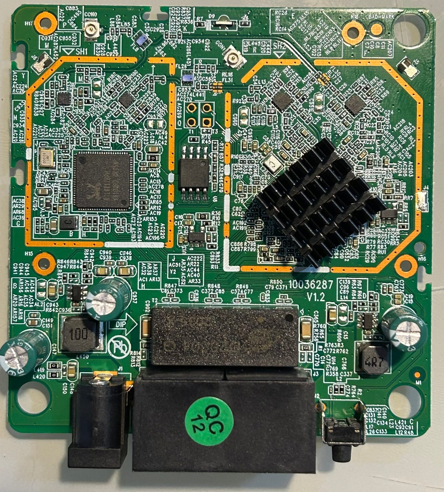

# Firmware: `chiconws` and `Twibify`

**English** | [Português](firmware.pt-BR.md)

Custom firmware built on top of the **official 1.1.11 rootfs**, keeping the stock kernel
(Linux 3.10.90) and partitions. Built by unpacking the official squashfs, editing the
userland and repacking with the correct checksum. `chiconws` (v20) was the first
experiment; **Twibify** (1.0) is the current, minimal firmware and lives in its own
repository: [`chiconws/twibify`](https://github.com/chiconws/twibify).

## What changes

| Item | Stock | `chiconws` |
|---|---|---|
| Remote access | telnet via `/goform/telnet` (plaintext) | **SSH** (static dropbear) |
| Tenda cloud (`ucloud`) | enabled | binary removed |
| TR-069 (`cwmpd`) | enabled | binary removed |
| Daily reboot 03:00 | enabled | disabled |
| Hostname | `Intelbras-<mac>` | `chiconws` |
| Banner (console and SSH) | — | `chiconws` |
| Web branding | Intelbras | `chiconws` (title + wordmark) |
| IoT range `192.168.6.200-254` | — | internet **on/off** |
| Web page + JSON API | — | `:8080` |

<p align="center">
  
</p>

## How it was built

1. `unsquashfs` of the official rootfs → `rootfs/`
2. Changes:
   - `webroot_ro/default.cfg`: `ucloud.en=0`, `cwmpd.en=0`,
     `sys.schedulereboot.enable=0`, `sys.hostname=chiconws`
   - removed `bin/ucloud` and `bin/cwmpd`
   - `etc_ro/issue` (banner), `etc_ro/hosts`
   - `etc_ro/passwd` + `etc_ro/shadow`: known root password
   - `etc_ro/dropbear/`: fixed ed25519 host key
   - `usr/sbin/dropbear` + `usr/bin/dropbearkey`: **static** mipsel binaries (musl)
   - `etc_ro/init.d/rcS`: banner, SSH, IoT range block, `twibi.lan`, web page
   - `usr/sbin/iotweb`: minimal HTTP server in C (page + JSON API)
   - `usr/sbin/iot-internet` and `usr/sbin/iot-host`: block control and reservations
   - `usr/sbin/gettemp`: reads the thermal meter
3. `mksquashfs` (xz, 128 KB) → new rootfs
4. `tools/mkimage_twibi.py` → image with the recomputed checksum
5. Flash it via disaster mode (`docs/recovery.md`)

## Access

```bash
ssh root@twibi.lan        # password defined in the image
http://twibi.lan:8080/    # page (Basic auth)
```

`twibi.lan` is resolved by the router's own DNS (`dnrd` + `/etc/dnrd/master`, generated at
boot with the current LAN IP), so it works for clients that use the Twibi as their DNS.

## IoT range (internet control)

The RTL865x switch routes/NATs **in hardware** and only knows the LAN and the WAN — you
cannot create a separate subnet as an alias. The solution was to reserve an **IP range on
the LAN itself** and block its egress to the WAN with iptables:

| Range | Rule |
|---|---|
| `192.168.6.2–199` | always with internet |
| `192.168.6.200–254` | internet controlled by `iot-internet on/off` |

```bash
iot-internet status         # IoT: 6.200-254 NO internet
iot-internet on|off
iot-host add <MAC> 192.168.6.220   # MAC -> IP reservation in the IoT range
iot-host list
```

`iot-internet off` applies `DROP` in `FORWARD` for `192.168.6.200/29`, `192.168.6.208/28`
and `192.168.6.224/27` on the way out to `eth1`/`ppp+` (WAN). The LAN stays reachable. A
watchdog in `rcS` reapplies the block if `netctrl` rewrites the firewall.

## Web page and API (port 8080)

| Endpoint | Content |
|---|---|
| `GET /` | page with status, buttons, reservations, RAM, uptime and thermal |
| `GET /api/mem` | memory: total/free/buffers/cached/available/used (kB) and % |
| `GET /api/temp` | `thermal_2g`, `thermal_5g` (relative ADC, not °C) |
| `GET /api/status` | uptime + memory + thermal + IoT internet state |

Basic auth (image user/password). Examples:

```bash
curl -u root:password http://twibi.lan:8080/api/status
```

## Notes

- The **LAN DHCP range** (ending at `.199`) was adjusted through the CFM because the LAN
  UI refuses the value when `.200` belongs to the IoT range. It persists in the CFM; a
  factory reset goes back to `.200`.
- With a static IP, the client must use **DNS `192.168.6.1`** to resolve `twibi.lan` and
  browse by name.
- The thermal is a relative Realtek meter (`/proc/wlan0/mib_all`), not a calibrated
  temperature.

## Twibify (current firmware)

A minimal derivation of the stock 1.1.11 — the cloud is **kept** (so the app still
manages the mesh) and only the insecure/undesired parts change:

| Item | Stock | Twibify |
|---|---|---|
| Remote access | telnet on demand | **SSH** (dropbear) |
| TR-069 (`cwmpd`) | enabled | `cwmpd.en=0`, binary removed |
| Cloud (`ucloud`) | enabled | **kept** (`ucloud.en=1`) |
| OTA (`sys.itbupgrade`) | enabled | disabled (empty URL) |
| Daily reboot 03:00 | enabled | disabled (both keys) |
| IoT | — | **per-MAC group** (no fixed IP range) |
| UI | — | **IoT page inside the original web UI** (replaces the TR-069 slot) |
| Branding | Intelbras | Intelbras + "firmware paralelo" footer |

Implementation notes:

- `rcS` forces `cwmpd.en=0`, `sys.itbupgrade.enable=0` (URL emptied),
  `sys.schedulereboot.enable=0`, `sched.reboot.enable=0` and `ucloud.en=1` via `cfm`, since
  the CMF survives a flash and would otherwise keep the old values.
- The **root password** is stored as an `$1$` (md5crypt) hash in `/etc/passwd` **and**
  `/etc/shadow`. It is applied **after** `cfmd`/`netctrl` (they rewrite `/etc/passwd`
  after `rcS`) and re-applied every 30 s; `cfm ssh.pwd` is the source of truth.
- SSH keys: `cfm ssh.key` → `/var/root/.ssh/authorized_keys` (the root home was changed
  to `/var/root` because `/` is read-only).
- The IoT page authenticates with a **per-boot token** in `/webroot/iot.token` (only
  readable by a logged-in web session) and calls a small backend on `:8080`.
- Keep `eth0`/`vlan1` untouched: the stock netctrl expects the original bridge layout.

## The stock web upgrade: works only with small images

`POST /goform/upgrade` (multipart, field **`upgradeFile`**) returns `{"errcode":"0"}`
when the upload fits the memory check, and `1005` when it does not.

- `errcode = |status| + 1000`; `1005` means status `-5`, which `cgi_upgrade` sets only
  when `cgi_upgrade_upload_file` returns `-2`, i.e. when `have_enough_mem()` fails.
- That function requires **`2 × content-length + 2 MB`** of free RAM: the upload body is
  already buffered when it runs. On a 44 MB Twibi with the mesh and cloud up, ~12.7 MB is
  free after `drop_caches`, so the image must be **≤ ~5.3 MB**.
- Proved on hardware: a 5,222,400 B image (minimal rootfs + TITB block) uploaded with
  `errcode 0`, `g_upgrade_flag=1`, `mesh_systool_write_image` erased and wrote the flash,
  and the device booted the new image. The full Twibify image (6.25 MB) does not fit.
- The **TITB** block: `netctrl`'s `upgrade_config_from_image` scans `/dev/mtdblock3` in
  4 KB steps for the magic `"TITB"`, decrypts 0x7FF4 bytes with the RC4 key
  `Tenda12345678abc` and validates `len` / `crc = sum(bytes) % 1000`; on success it writes
  `/webroot/default.cfg`. `tools/mktitb.py` builds the block, but the device still logged
  `len = 0, crc = 0` — the placement/format needs more work and it is **not required to
  flash** (the write happens regardless).

So the web upgrade is usable for images up to ~5.3 MB; bigger images go through disaster
mode + TFTP.

## Mesh with a modified master

The mesh stack (`mpp`, `nos.ko`, `/proc/mesh/*`, `wl*.mesh.*`) is **untouched**. Since
Twibify is built from the same 1.1.11 base, a stock node is expected to pair normally, but
this was **not tested** — do it in a lab with one stock node before touching production.

## Root password: the `cfmd` race

`dropbear` authenticates against **`/etc/passwd`** (not `/etc/shadow`) on this firmware.
`cfmd`/`netctrl` rewrite `/etc/passwd` after `rcS`, so a password applied too early is
lost (symptom: the console loops `sulogin: no pass` and SSH rejects everything). The fix
is to apply the hash **after** the config daemons and keep re-applying it.
