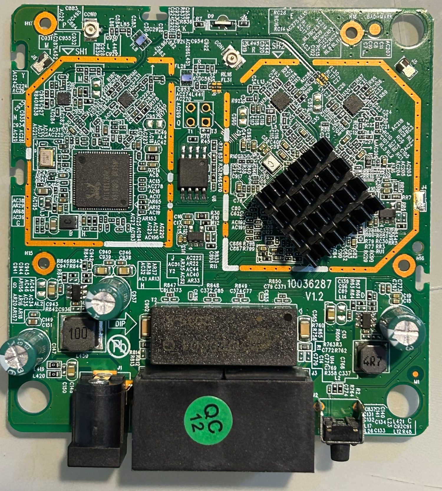

# The `chiconws` firmware

**English** | [Português](firmware.pt-BR.md)

Custom firmware built on top of the **official 1.1.11 rootfs**, keeping the stock kernel
(Linux 3.10.90) and partitions. Built by unpacking the official squashfs, editing the
userland and repacking with the correct checksum.

## What changes

| Item | Stock | `chiconws` |
|---|---|---|
| Remote access | telnet via `/goform/telnet` (plaintext) | **SSH** (static dropbear) |
| Tenda cloud (`ucloud`) | enabled | binary removed |
| TR-069 (`cwmpd`) | enabled | binary removed |
| Daily reboot 03:00 | enabled | disabled |
| Hostname | `Intelbras-<mac>` | `chiconws` |
| Banner (console and SSH) | — | `chiconws` |
| Web branding | Intelbras | `chiconws` (title + wordmark) |
| IoT range `192.168.6.200-254` | — | internet **on/off** |
| Web page + JSON API | — | `:8080` |

<p align="center">
  
</p>

## How it was built

1. `unsquashfs` of the official rootfs → `rootfs/`
2. Changes:
   - `webroot_ro/default.cfg`: `ucloud.en=0`, `cwmpd.en=0`,
     `sys.schedulereboot.enable=0`, `sys.hostname=chiconws`
   - removed `bin/ucloud` and `bin/cwmpd`
   - `etc_ro/issue` (banner), `etc_ro/hosts`
   - `etc_ro/passwd` + `etc_ro/shadow`: known root password
   - `etc_ro/dropbear/`: fixed ed25519 host key
   - `usr/sbin/dropbear` + `usr/bin/dropbearkey`: **static** mipsel binaries (musl)
   - `etc_ro/init.d/rcS`: banner, SSH, IoT range block, `twibi.lan`, web page
   - `usr/sbin/iotweb`: minimal HTTP server in C (page + JSON API)
   - `usr/sbin/iot-internet` and `usr/sbin/iot-host`: block control and reservations
   - `usr/sbin/gettemp`: reads the thermal meter
3. `mksquashfs` (xz, 128 KB) → new rootfs
4. `tools/mkimage_twibi.py` → image with the recomputed checksum
5. Flash it via disaster mode (`docs/recovery.md`)

## Access

```bash
ssh root@twibi.lan        # password defined in the image
http://twibi.lan:8080/    # page (Basic auth)
```

`twibi.lan` is resolved by the router's own DNS (`dnrd` + `/etc/dnrd/master`, generated at
boot with the current LAN IP), so it works for clients that use the Twibi as their DNS.

## IoT range (internet control)

The RTL865x switch routes/NATs **in hardware** and only knows the LAN and the WAN — you
cannot create a separate subnet as an alias. The solution was to reserve an **IP range on
the LAN itself** and block its egress to the WAN with iptables:

| Range | Rule |
|---|---|
| `192.168.6.2–199` | always with internet |
| `192.168.6.200–254` | internet controlled by `iot-internet on/off` |

```bash
iot-internet status         # IoT: 6.200-254 NO internet
iot-internet on|off
iot-host add <MAC> 192.168.6.220   # MAC -> IP reservation in the IoT range
iot-host list
```

`iot-internet off` applies `DROP` in `FORWARD` for `192.168.6.200/29`, `192.168.6.208/28`
and `192.168.6.224/27` on the way out to `eth1`/`ppp+` (WAN). The LAN stays reachable. A
watchdog in `rcS` reapplies the block if `netctrl` rewrites the firewall.

## Web page and API (port 8080)

| Endpoint | Content |
|---|---|
| `GET /` | page with status, buttons, reservations, RAM, uptime and thermal |
| `GET /api/mem` | memory: total/free/buffers/cached/available/used (kB) and % |
| `GET /api/temp` | `thermal_2g`, `thermal_5g` (relative ADC, not °C) |
| `GET /api/status` | uptime + memory + thermal + IoT internet state |

Basic auth (image user/password). Examples:

```bash
curl -u root:password http://twibi.lan:8080/api/status
```

## Notes

- The **LAN DHCP range** (ending at `.199`) was adjusted through the CFM because the LAN
  UI refuses the value when `.200` belongs to the IoT range. It persists in the CFM; a
  factory reset goes back to `.200`.
- With a static IP, the client must use **DNS `192.168.6.1`** to resolve `twibi.lan` and
  browse by name.
- The thermal is a relative Realtek meter (`/proc/wlan0/mib_all`), not a calibrated
  temperature.
