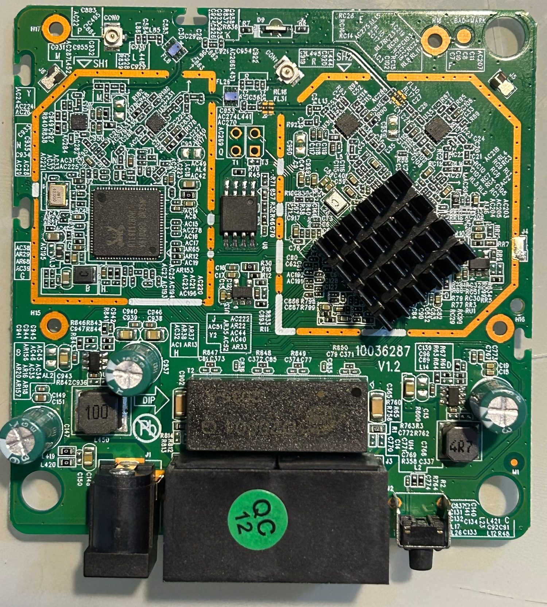

# Firmware `chiconws`

[English](firmware.md) | **Português**

Firmware customizado sobre o **rootfs oficial 1.1.11**, mantendo o kernel de fábrica
(Linux 3.10.90) e as partições. Construído desempacotando o squashfs oficial, editando
o userland e reempacotando com o checksum correto.

## O que muda

| Item | Original | `chiconws` |
|---|---|---|
| Acesso remoto | telnet via `/goform/telnet` (texto claro) | **SSH** (dropbear estático) |
| Nuvem Tenda (`ucloud`) | ativo | binário removido |
| TR-069 (`cwmpd`) | ativo | binário removido |
| Reboot diário 03:00 | ativo | desligado |
| Hostname | `Intelbras-<mac>` | `chiconws` |
| Banner (console e SSH) | — | `chiconws` |
| Branding da web | Intelbras | `chiconws` (título + wordmark) |
| Faixa IoT `192.168.6.200-254` | — | internet **ligável/desligável** |
| Página web + API JSON | — | `:8080` |

<p align="center">
  
</p>

## Como foi construído

1. `unsquashfs` do rootfs oficial → `rootfs/`
2. Edições:
   - `webroot_ro/default.cfg`: `ucloud.en=0`, `cwmpd.en=0`,
     `sys.schedulereboot.enable=0`, `sys.hostname=chiconws`
   - remoção de `bin/ucloud` e `bin/cwmpd`
   - `etc_ro/issue` (banner), `etc_ro/hosts`
   - `etc_ro/passwd` + `etc_ro/shadow`: senha de root conhecida
   - `etc_ro/dropbear/`: chave de host ed25519 fixa
   - `usr/sbin/dropbear` + `usr/bin/dropbearkey`: binários **estáticos** mipsel (musl)
   - `etc_ro/init.d/rcS`: banner, SSH, bloqueio da faixa IoT, `twibi.lan`, página web
   - `usr/sbin/iotweb`: servidor HTTP mínimo em C (página + API JSON)
   - `usr/sbin/iot-internet` e `usr/sbin/iot-host`: controle do bloqueio e reservas
   - `usr/sbin/gettemp`: leitura do thermal meter
3. `mksquashfs` (xz, 128 KB) → rootfs novo
4. `tools/mkimage_twibi.py` → imagem com o checksum recalculado
5. Gravação pelo disaster mode (`docs/recovery.pt-BR.md`)

## Acessos

```bash
ssh root@twibi.lan        # senha definida na imagem
http://twibi.lan:8080/    # página (Basic auth)
```

`twibi.lan` resolve pelo DNS do próprio roteador (`dnrd` + `/etc/dnrd/master`, gerado no
boot com o IP atual da LAN), então funciona nos clientes que usam o Twibi como DNS.

## Faixa IoT (controle de internet)

O switch do RTL865x roteia/NATeia **em hardware** e só conhece a LAN e a WAN — não dá
para criar uma sub-rede separada como alias. A solução foi reservar uma **faixa de IP na
própria LAN** e bloquear a saída dela para o WAN via iptables:

| Faixa | Regra |
|---|---|
| `192.168.6.2–199` | sempre com internet |
| `192.168.6.200–254` | internet controlada por `iot-internet on/off` |

```bash
iot-internet status         # IoT: 6.200-254 SEM internet
iot-internet on|off
iot-host add <MAC> 192.168.6.220   # reserva MAC -> IP na faixa IoT
iot-host list
```

O `iot-internet off` aplica `DROP` em `FORWARD` para `192.168.6.200/29`,
`192.168.6.208/28` e `192.168.6.224/27` na saída para `eth1`/`ppp+` (WAN). A LAN
continua acessível. Um vigia no `rcS` reaplica o bloqueio se o `netctrl` reescrever o
firewall.

## Página web e API (porta 8080)

| Endpoint | Conteúdo |
|---|---|
| `GET /` | página com status, botões, reservas, RAM, uptime e thermal |
| `GET /api/mem` | memória: total/free/buffers/cached/available/used (kB) e % |
| `GET /api/temp` | `thermal_2g`, `thermal_5g` (ADC relativo, não °C) |
| `GET /api/status` | uptime + memória + thermal + estado da internet IoT |

Basic auth (usuário/senha da imagem). Exemplos:

```bash
curl -u root:senha http://twibi.lan:8080/api/status
```

## Observações

- A **faixa DHCP da LAN** (fim em `.199`) foi ajustada pela CFM porque a UI de LAN recusa
  o valor quando o `.200` pertence à faixa IoT. Persiste na CFM; um reset de fábrica
  volta para `.200`.
- Em IP fixo, o cliente precisa usar **DNS `192.168.6.1`** para resolver `twibi.lan` e
  acessar a internet por nome.
- O thermal é um medidor relativo da Realtek (`/proc/wlan0/mib_all`), não uma
  temperatura calibrada.
