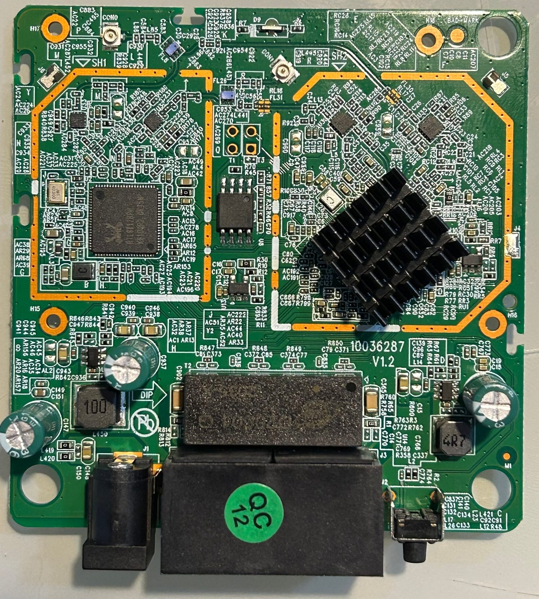

# Firmware: `chiconws` e `Twibify`

[English](firmware.md) | **Português**

Firmware customizado sobre o **rootfs oficial 1.1.11**, mantendo o kernel de fábrica
(Linux 3.10.90) e as partições. Construído desempacotando o squashfs oficial, editando
o userland e reempacotando com o checksum correto. O `chiconws` (v20) foi a primeira
experiência; o **Twibify** (1.0) é o firmware atual, mínimo, e fica em repositório
próprio: [`chiconws/twibify`](https://github.com/chiconws/twibify).

## O que muda

| Item | Original | `chiconws` |
|---|---|---|
| Acesso remoto | telnet via `/goform/telnet` (texto claro) | **SSH** (dropbear estático) |
| Nuvem Tenda (`ucloud`) | ativo | binário removido |
| TR-069 (`cwmpd`) | ativo | binário removido |
| Reboot diário 03:00 | ativo | desligado |
| Hostname | `Intelbras-<mac>` | `chiconws` |
| Banner (console e SSH) | — | `chiconws` |
| Branding da web | Intelbras | `chiconws` (título + wordmark) |
| Faixa IoT `192.168.6.200-254` | — | internet **ligável/desligável** |
| Página web + API JSON | — | `:8080` |

<p align="center">
  
</p>

## Como foi construído

1. `unsquashfs` do rootfs oficial → `rootfs/`
2. Edições:
   - `webroot_ro/default.cfg`: `ucloud.en=0`, `cwmpd.en=0`,
     `sys.schedulereboot.enable=0`, `sys.hostname=chiconws`
   - remoção de `bin/ucloud` e `bin/cwmpd`
   - `etc_ro/issue` (banner), `etc_ro/hosts`
   - `etc_ro/passwd` + `etc_ro/shadow`: senha de root conhecida
   - `etc_ro/dropbear/`: chave de host ed25519 fixa
   - `usr/sbin/dropbear` + `usr/bin/dropbearkey`: binários **estáticos** mipsel (musl)
   - `etc_ro/init.d/rcS`: banner, SSH, bloqueio da faixa IoT, `twibi.lan`, página web
   - `usr/sbin/iotweb`: servidor HTTP mínimo em C (página + API JSON)
   - `usr/sbin/iot-internet` e `usr/sbin/iot-host`: controle do bloqueio e reservas
   - `usr/sbin/gettemp`: leitura do thermal meter
3. `mksquashfs` (xz, 128 KB) → rootfs novo
4. `tools/mkimage_twibi.py` → imagem com o checksum recalculado
5. Gravação pelo disaster mode (`docs/recovery.pt-BR.md`)

## Acessos

```bash
ssh root@twibi.lan        # senha definida na imagem
http://twibi.lan:8080/    # página (Basic auth)
```

`twibi.lan` resolve pelo DNS do próprio roteador (`dnrd` + `/etc/dnrd/master`, gerado no
boot com o IP atual da LAN), então funciona nos clientes que usam o Twibi como DNS.

## Faixa IoT (controle de internet)

O switch do RTL865x roteia/NATeia **em hardware** e só conhece a LAN e a WAN — não dá
para criar uma sub-rede separada como alias. A solução foi reservar uma **faixa de IP na
própria LAN** e bloquear a saída dela para o WAN via iptables:

| Faixa | Regra |
|---|---|
| `192.168.6.2–199` | sempre com internet |
| `192.168.6.200–254` | internet controlada por `iot-internet on/off` |

```bash
iot-internet status         # IoT: 6.200-254 SEM internet
iot-internet on|off
iot-host add <MAC> 192.168.6.220   # reserva MAC -> IP na faixa IoT
iot-host list
```

O `iot-internet off` aplica `DROP` em `FORWARD` para `192.168.6.200/29`,
`192.168.6.208/28` e `192.168.6.224/27` na saída para `eth1`/`ppp+` (WAN). A LAN
continua acessível. Um vigia no `rcS` reaplica o bloqueio se o `netctrl` reescrever o
firewall.

## Página web e API (porta 8080)

| Endpoint | Conteúdo |
|---|---|
| `GET /` | página com status, botões, reservas, RAM, uptime e thermal |
| `GET /api/mem` | memória: total/free/buffers/cached/available/used (kB) e % |
| `GET /api/temp` | `thermal_2g`, `thermal_5g` (ADC relativo, não °C) |
| `GET /api/status` | uptime + memória + thermal + estado da internet IoT |

Basic auth (usuário/senha da imagem). Exemplos:

```bash
curl -u root:senha http://twibi.lan:8080/api/status
```

## Observações

- A **faixa DHCP da LAN** (fim em `.199`) foi ajustada pela CFM porque a UI de LAN recusa
  o valor quando o `.200` pertence à faixa IoT. Persiste na CFM; um reset de fábrica
  volta para `.200`.
- Em IP fixo, o cliente precisa usar **DNS `192.168.6.1`** para resolver `twibi.lan` e
  acessar a internet por nome.
- O thermal é um medidor relativo da Realtek (`/proc/wlan0/mib_all`), não uma
  temperatura calibrada.

## Twibify (firmware atual)

Derivado mínimo do 1.1.11 oficial — a **nuvem é mantida** (o app continua gerenciando o
mesh) e só o que é inseguro/indesejado muda:

| Item | Original | Twibify |
|---|---|---|
| Acesso remoto | telnet sob demanda | **SSH** (dropbear) |
| TR-069 (`cwmpd`) | ativo | `cwmpd.en=0`, binário removido |
| Nuvem (`ucloud`) | ativo | **mantida** (`ucloud.en=1`) |
| OTA (`sys.itbupgrade`) | ativo | desligado (URL vazia) |
| Reboot diário 03:00 | ativo | desligado (as duas chaves) |
| IoT | — | **grupo por MAC** (sem faixa fixa de IP) |
| UI | — | **página IoT dentro da webui original** (no lugar do TR-069) |
| Branding | Intelbras | Intelbras + rodapé "firmware paralelo" |

Notas de implementação:

- O `rcS` força `cwmpd.en=0`, `sys.itbupgrade.enable=0` (URL vazia),
  `sys.schedulereboot.enable=0`, `sched.reboot.enable=0` e `ucloud.en=1` via `cfm`, porque
  o CMF sobrevive ao flash e manteria os valores antigos.
- A **senha do root** fica em hash `$1$` (md5crypt) no `/etc/passwd` **e** no
  `/etc/shadow`. É aplicada **depois** do `cfmd`/`netctrl` (que reescrevem o `/etc/passwd`
  após o `rcS`) e reaplicada a cada 30 s; o `cfm ssh.pwd` é a fonte da verdade.
- Chaves SSH: `cfm ssh.key` → `/var/root/.ssh/authorized_keys` (a home do root foi mudada
  para `/var/root` porque `/` é somente leitura).
- A página IoT autentica com um **token por boot** em `/webroot/iot.token` (só legível por
  sessão logada) e chama um backend pequeno na `:8080`.
- Não mexa no `eth0`/`vlan1`: o netctrl original espera o layout de bridge original.

## Por que o upgrade da web original rejeita a imagem (errcode 1005)

`POST /goform/upgrade` (multipart, campo **`upgradeFile`**) aceita o upload (6–7 MB em
~4 s) e responde `{"errcode":"1005"}` — tanto para a **imagem oficial 1.1.11** quanto para
uma customizada. O front-end só trata três códigos de erro, então mostra a barra
"Atualizando…" animada mesmo sem gravar nada.

O código mostra **dois bloqueios independentes**:

1. **Memória.** `errcode = |status| + 1000`; `1005` significa status `-5`, que o
   `cgi_upgrade` só define quando `cgi_upgrade_upload_file` retorna `-2`, ou seja, quando
   `have_enough_mem()` falha. Essa função exige **`content-length + 2 MB`** de RAM livre
   depois de dropar caches e matar `smbd`/`nmbd`/`stupid-ftpd`/`minidlna`. O console mostra
   `current remain memory is 8,5 MB / 8,3 MB / 8,1 MB`; um upload de 6,8 MB precisa de
   8,8 MB e falha, o de 6,4 MB (oficial) passa por pouco.
2. **Empacotamento.** Quando a memória permite, o `upgrade_config_from_image` do `netctrl`
   abre `/dev/mtdblock3`, varre em passos de 4 KB procurando o magic **`"TITB"`**, e então
   *decripta* um cabeçalho de 12 bytes e confere `len`/`crc`. Nenhum dos `.bin` puros
   (oficial, Twibify, payloads) contém `"TITB"` — o log mostra
   `header->len = 0, crc=0x0` / `Length error`. O upgrade da web espera um **pacote de
   atualização do fabricante** (imagem + bloco TITB cifrado), não a imagem do bootloader.

Então o upgrade local pela web não é utilizável com essas imagens: grava-se por
**disaster mode + TFTP**, ou pelo OTA da nuvem (que instala o firmware oficial).

## Mesh com mestre modificado

O stack de mesh (`mpp`, `nos.ko`, `/proc/mesh/*`, `wl*.mesh.*`) fica **intocado**. Como o
Twibify é feito da mesma base 1.1.11, espera-se que um node stock pareie normalmente, mas
isso **não foi testado** — faça em laboratório com um node stock antes de mexer em
produção.

## Senha do root: a corrida com o `cfmd`

O `dropbear` autentica pelo **`/etc/passwd`** (não pelo `/etc/shadow`) neste firmware. O
`cfmd`/`netctrl` reescreve o `/etc/passwd` depois do `rcS`, então uma senha aplicada cedo
demais se perde (sintoma: o console entra em loop `sulogin: no pass` e o SSH recusa tudo).
A correção é aplicar o hash **depois** dos daemons de config e continuar reaplicando.
