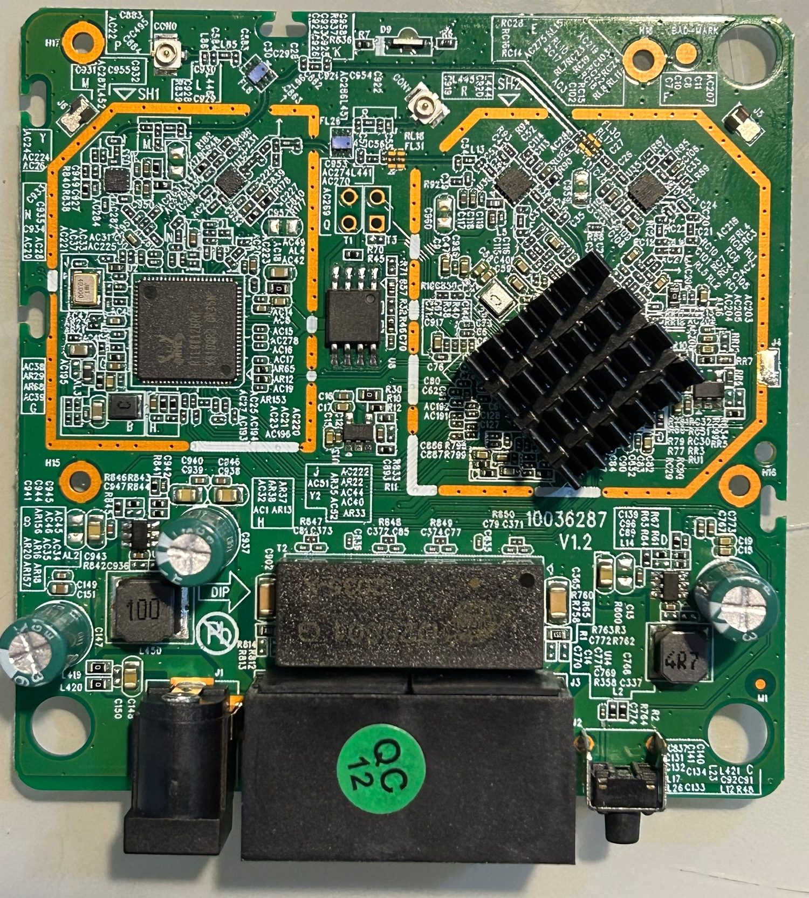
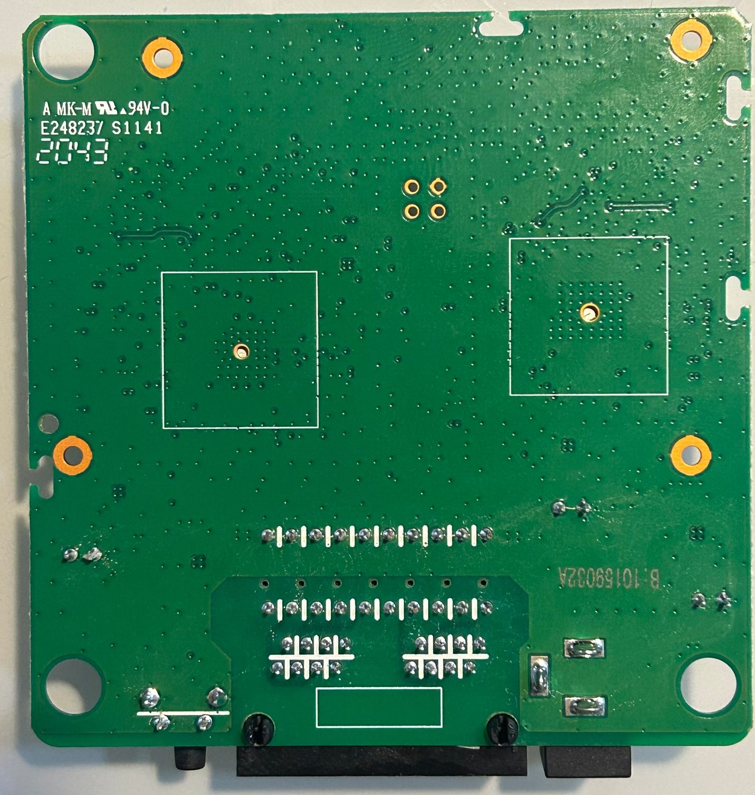
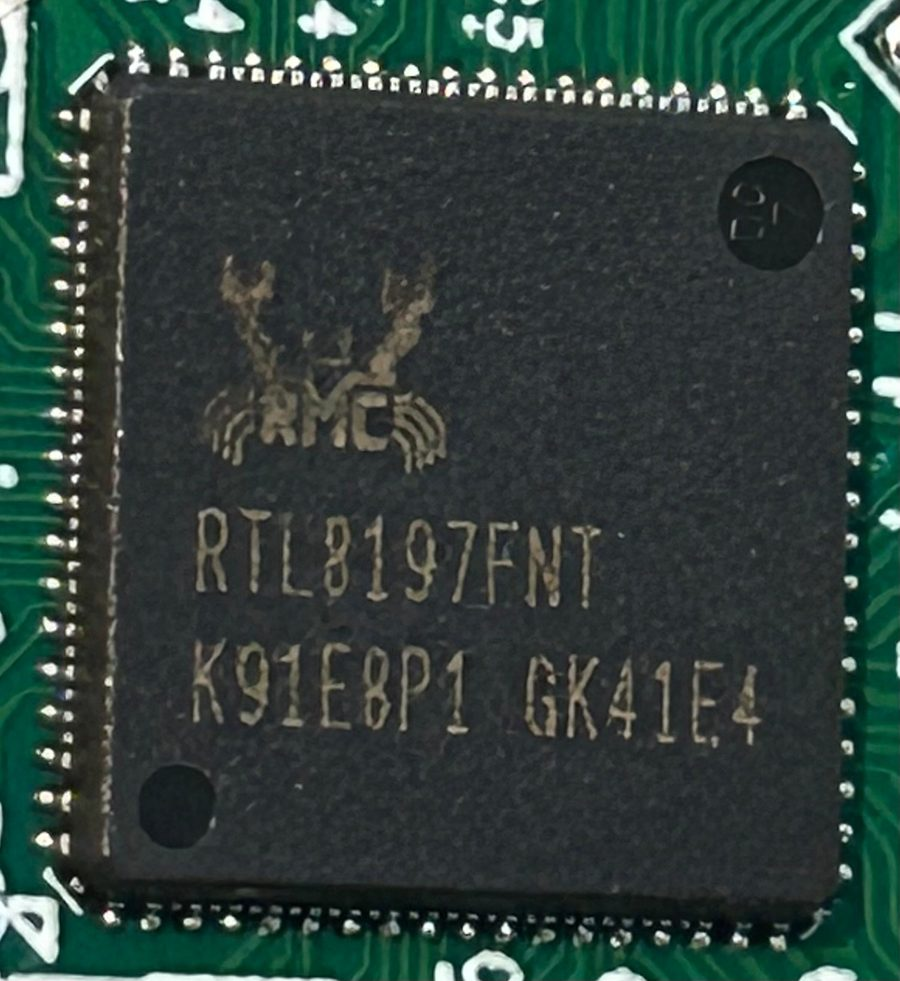
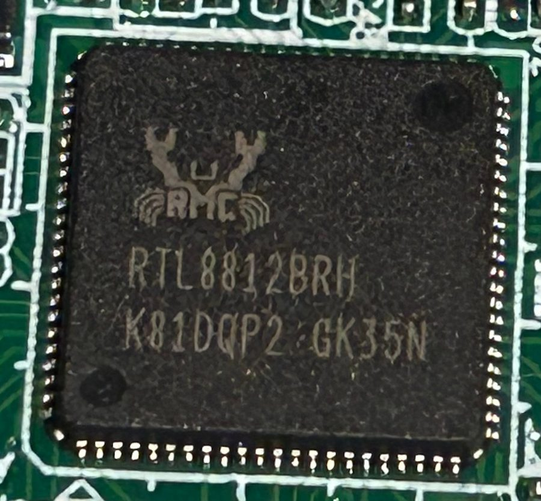
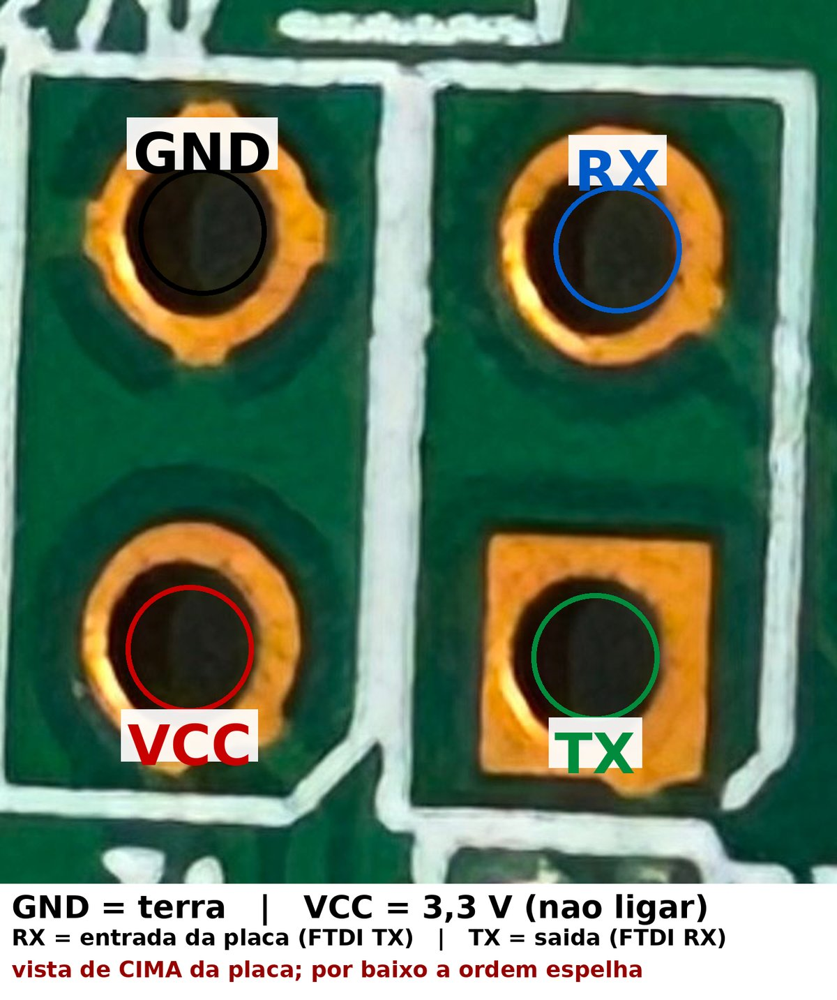
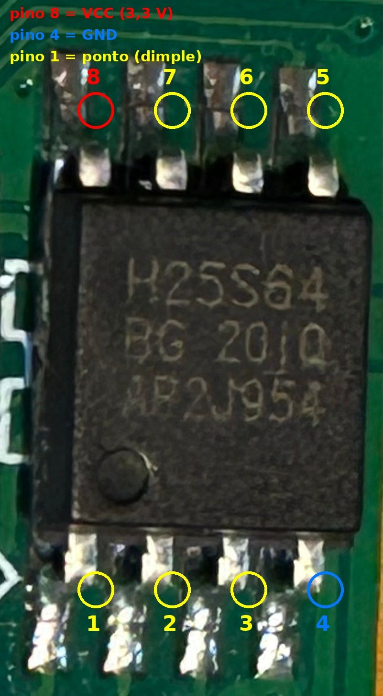

# Hardware

**English** | [Português](hardware.pt-BR.md)

## Board

- ~79 × 79 mm PCB, chamfered corners, 4 mounting holes
- **Realtek RTL8197FNT** SoC (MIPS 24Kc @ 600 MHz, 64 MB DDR2 **in-package**) under a
  heatsink
- **RTL8812BRH** 5 GHz radio (802.11ac 2×2), 2.4 GHz integrated in the SoC
- **8 MB** SPI flash — BOHONG **BH25Q64**
- 2× 100 Mbps Ethernet ports (one of them is **auto WAN/LAN**)
- **9 V / 1 A** supply, DC jack **center positive**

Top and bottom sides:

<p align="center">
  
  
</p>

Chip close-ups:

<p align="center">
  
  
</p>

## Power

The jack sleeve has continuity with the board GND — that is, **center positive**.
Measured unloaded: ~9.35 V. The device draws well under 1 A.

## UART

The board's serial console. Accessed with a **USB → serial FTDI232** adapter at **3.3 V**,
wiring only **GND, TX and RX** (the adapter VCC is not used — the board has its own
supply). 2×2 pads, `115200 8N1`:

<p align="center">
  
</p>

| Pad | Signal |
|---|---|
| 1 | GND |
| 2 | RX (board input) |
| 3 | VCC 3.3 V — do not connect |
| 4 | TX (board output) |

## Flash

SOIC-8 **BH25Q64** (8 MB / 64 KB sectors). For direct read/write with a SOIC-8 clip +
CH341A the pinout is standard (pin 1 = dot, counter-clockwise):

<p align="center">
  
</p>

- pin 8 = VCC (3.3 V)
- pin 4 = GND
- pin 1 = CS

The partition layout is in [`recovery.md`](recovery.md#5-flash-layout-8-mb).

## Boot log (summary)

```
DRAM Type: DDR2, 533MHz, Size: 64MB
found BH25Q64, flash vendor: BOHONG, size=8MB, erasesize=64KB
Boot release version:247 (May 11 2018-08:41:38) (600MHz)
Linux version 3.10.90 (gcc 4.4.7 Realtek MSDK)
Kernel code size:0x1ed412
9 rtkxxpart partitions found on MTD device m25p80
```

The kernel uses **squashfs 4.0 (xz)** and the bootloader validates the rootfs by checksum
(see `recovery.md`).

## Switch / network

The integrated switch (RTL865x) is visible under `/proc/rtl865x/` (`port_status`, `vlan`,
`arp`, `l3`, `ip`, `netif`). It does **hardware routing and NAPT**:

- `VID 9` → LAN (`br0`)
- `VID 8` → WAN (`eth1`)
- L3 table with `192.168.6.0/24` (LAN), `192.168.1.0/24` (WAN) and a default via WAN

That is why an extra subnet only works up to the router itself — forwarded traffic dies in
the switch, which has no L3/NAPT entry for it.

## LEDs

Two LEDs on the board edge (D9/D6), next to the connector, used as the front indicator.
The firmware's status LED stays steady when boot fails — that was the first symptom of the
bricked unit.
