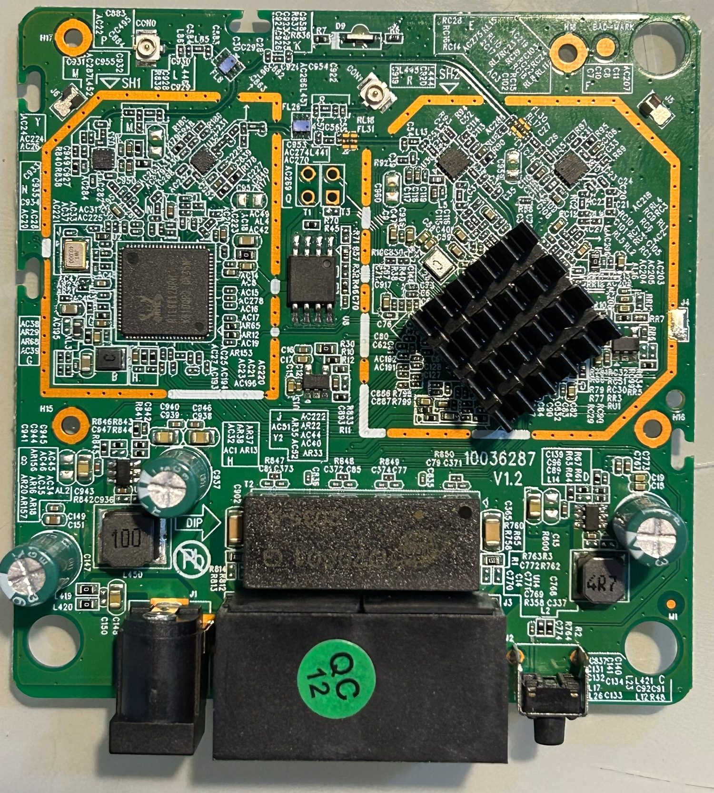
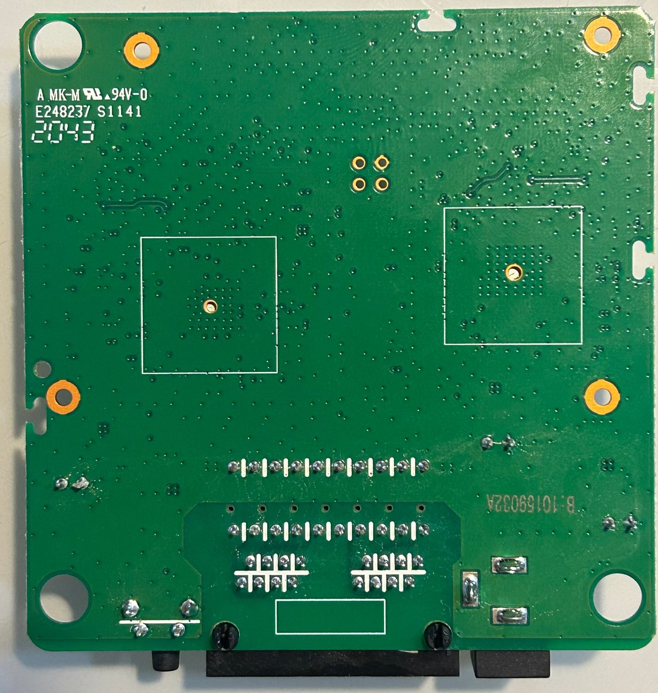
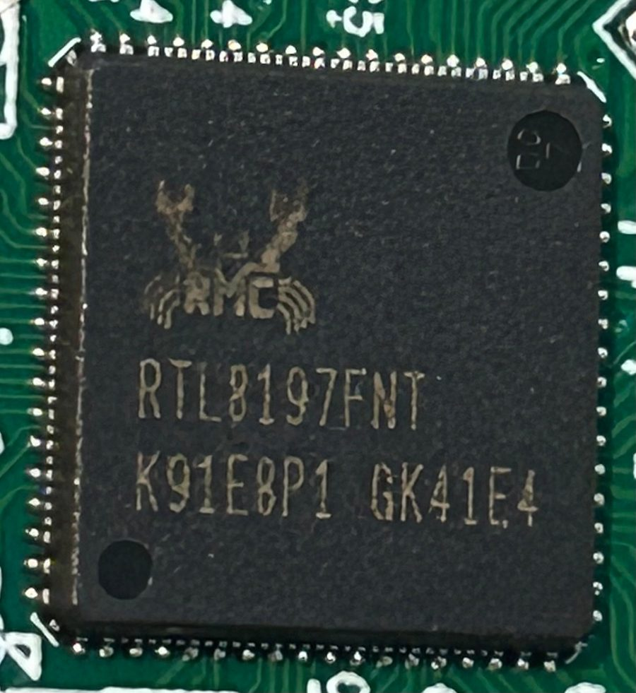
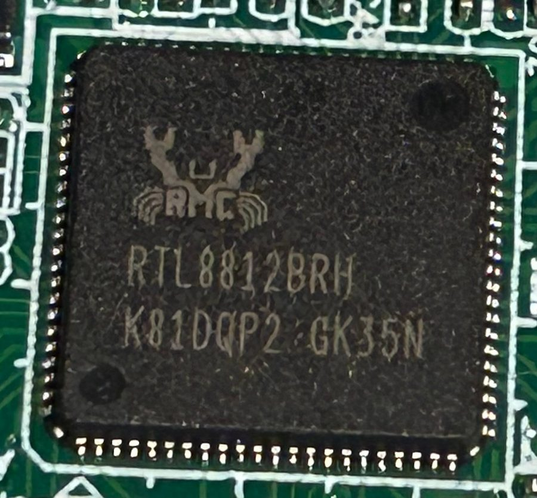
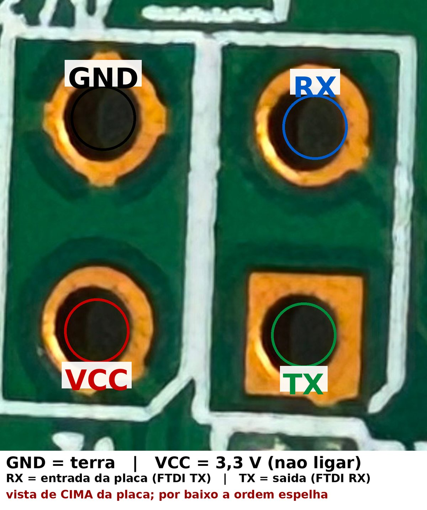
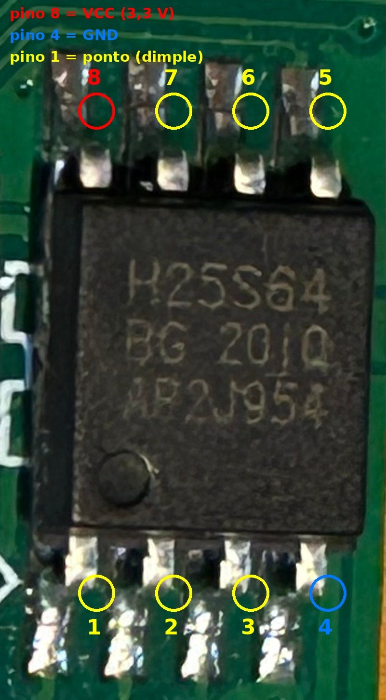

# Hardware

[English](hardware.md) | **Português**

## Placa

- Placa ~79 × 79 mm, cantos chanfrados, 4 furos de fixação
- SoC **Realtek RTL8197FNT** (MIPS 24Kc @ 600 MHz, DRAM DDR2 64 MB **no pacote**)
  sob um dissipador
- Rádio 5 GHz **RTL8812BRH** (802.11ac 2×2), 2,4 GHz integrado ao SoC
- Flash SPI **8 MB** — BOHONG **BH25Q64**
- 2 portas Ethernet 100 Mbps (uma delas é **WAN/LAN automática**)
- Alimentação **9 V / 1 A**, jack DC **centro positivo**

Vista superior e inferior:

<p align="center">
  
  
</p>

Detalhes dos chips:

<p align="center">
  
  
</p>

## Alimentação

O sleeve do jack tem continuidade com o GND da placa — ou seja, **centro positivo**.
Medido em vazio: ~9,35 V. O consumo do aparelho fica abaixo de 1 A.

## UART

O console serial da placa. É acessado com um adaptador **USB → serial FTDI232**, em
**3,3 V**, ligando apenas **GND, TX e RX** (o VCC do adaptador não é usado — a placa tem
fonte própria). Pads 2×2, `115200 8N1`:

<p align="center">
  
</p>

| Pad | Sinal |
|---|---|
| 1 | GND |
| 2 | RX (entrada da placa) |
| 3 | VCC 3,3 V — não ligar |
| 4 | TX (saída da placa) |

## Flash

SOIC-8 **BH25Q64** (8 MB / 64 KB de setor). Para leitura/gravação direta com clipe
SOIC-8 + CH341A, a pinagem é a padrão (pino 1 = ponto, contagem anti-horária):

<p align="center">
  
</p>

- pino 8 = VCC (3,3 V)
- pino 4 = GND
- pino 1 = CS

O layout das partições está em [`recovery.pt-BR.md`](recovery.pt-BR.md#5-layout-da-flash-8-mb).

## Boot log (resumo)

```
DRAM Type: DDR2, 533MHz, Size: 64MB
found BH25Q64, flash vendor: BOHONG, size=8MB, erasesize=64KB
Boot release version:247 (May 11 2018-08:41:38) (600MHz)
Linux version 3.10.90 (gcc 4.4.7 Realtek MSDK)
Kernel code size:0x1ed412
9 rtkxxpart partitions found on MTD device m25p80
```

O kernel usa **squashfs 4.0 (xz)** e o bootloader valida o rootfs por checksum
(ver `recovery.pt-BR.md`).

## Switch / rede

O switch integrado (RTL865x) é visível em `/proc/rtl865x/` (`port_status`, `vlan`,
`arp`, `l3`, `ip`, `netif`). Ele faz **roteamento e NAPT em hardware**:

- `VID 9` → LAN (`br0`)
- `VID 8` → WAN (`eth1`)
- Tabela L3 com `192.168.6.0/24` (LAN), `192.168.1.0/24` (WAN) e default via WAN

É por isso que uma sub-rede extra só funciona até o próprio roteador — o tráfego
encaminhado para fora morre no switch, que não tem entrada L3/NAPT para ela.

## LED

Dois LEDs na borda da placa (D9/D6), próximos ao conector, usados como indicador
frontal. O LED de estado do firmware fica fixo quando o boot falha — foi o sintoma
inicial do aparelho brickado.
