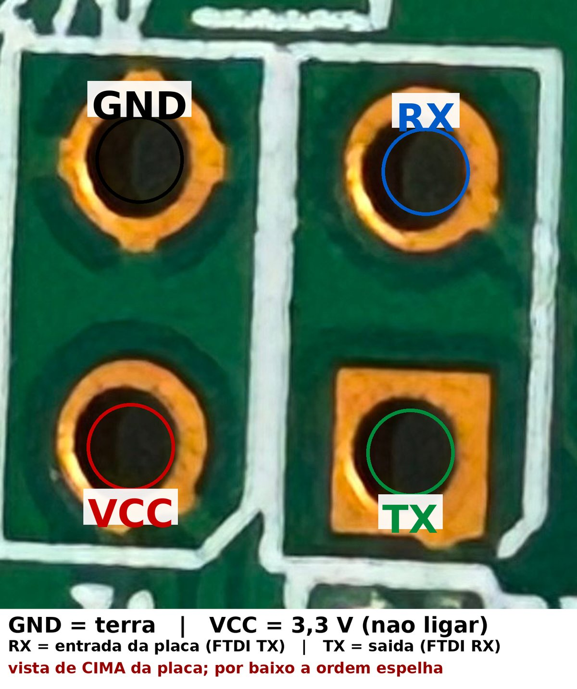

# Twibi Fast recovery (disaster mode + TFTP)

**English** | [Português](recovery.pt-BR.md)

Procedure used to resurrect a unit that would not boot (`rootfs checksum error`), and
also to flash any new firmware.

## 1. Brick symptoms

- LED steady on, no SSID, no DHCP
- Network link up but **0 bytes received** (not transmitting)
- Reset button doing nothing (the button is read by the firmware, not the hardware)

On the UART console:

```
Booting...
DRAM Type: DDR2, 533MHz, Size: 64MB
found BH25Q64, size=8MB
Boot release version:247 (May 11 2018) (600MHz)
wait for upgrage
rootfs checksum error at 0021D012!
<RealTek>
```

The rootfs was truncated: the squashfs superblock said 3.39 MB, but from `0x220000`
onwards the flash was all `0xFF`.

## 2. UART (serial console)

**What it is:** the UART is the device's text console. It works from the bootloader
onwards, independent of network or OS — like "plugging a keyboard and a monitor" into the
board. With a corrupted flash it was the only way to see the error
(`rootfs checksum error`) and to confirm the bootloader was still alive.

**What you need:** a **USB → serial FTDI232** adapter (FT232RL), one of those with a
3.3 V/5 V jumper. It shows up on the PC as `/dev/ttyUSB0` (Linux) or `COMx` (Windows) and
does **not** power the board — the Twibi uses its 9 V supply. Set the jumper to **3.3 V**
(the board is 3.3 V; 5 V can damage the SoC).

2×2 pads on the board (top view):

<p align="center">
  
</p>

| Pad | Signal | Adapter side |
|---|---|---|
| 1 | GND | GND |
| 2 | RX (input) | adapter TX |
| 3 | VCC 3.3 V | **nothing** |
| 4 | TX (output) | adapter RX |

`115200 8N1`. Connect **GND first** (without it the console stays silent and the board's
RX may float, printing `<RealTek>` endlessly). Do not connect the adapter's VCC to pad 3 —
the Twibi is already powered by its supply.

Any serial terminal works:

- Linux: `picocom -b 115200 /dev/ttyUSB0`, `minicom -D /dev/ttyUSB0 -b 115200` or
  `screen /dev/ttyUSB0 115200`
- Windows: PuTTY in Serial mode, 115200, 8N1
- The full project includes `tools/uart_console.py` (console with logging and FIFO commands)

## 3. Disaster mode

1. Power off.
2. Hold **reset**.
3. Power on and keep reset held for ~5 s.
4. Release: the console shows `Entry disaster mode` and the bootloader starts TFTP on
   **`192.168.1.6`** (Realtek default).

## 4. Sending the image (Ethernet cable, not UART)

The transfer happens **over the network cable**: the PC sits in `192.168.1.0/24`, the
bootloader listens for TFTP on `192.168.1.6` and receives the file. The **UART does not
carry the image** — it is only there to watch the console and follow the process.

The uploaded file is the **official `.bin` payload without the 64-byte uImage header**:

```bash
# official .bin -> payload
python3 - <<'EOF'
d = open('twibi_fast_1.1.11.bin','rb').read()
open('payload.bin','wb').write(d[0x40:])
EOF

# PC with an IP in 192.168.1.0/24, then:
python3 tools/tftp_put.py 192.168.1.6 payload.bin --name payload.bin
```

The bootloader recognizes the image by itself:

```
**TFTP Client Upload File Size = 00615414 Bytes at A0A00000
Success!
Linux kernel (root-fs) upgrade.
checksum Ok !
burn kernel-fs Addr:0x00030000 srcAddr:0xa0a00000 len:0x001ed412
squashfs upgrade.
checksum Ok !
burn rootfs first aligned block
burn rootfs Addr:0x00220000! srcAddr:0xa0bf0000 len:0x00425414
reboot.......
```

UART is not required for the transfer — only to watch/diagnose. Disaster mode is triggered
by reset at power-on and TFTP is plain Ethernet.

## 5. Flash layout (8 MB)

| Offset | Size | Partition |
|---|---|---|
| `0x000000` | 128 KB | `Bootloader` |
| `0x020000` | 64 KB | `CFG` |
| `0x030000` | 7.5 MB | `KernelFS` (`cr6c` kernel + rootfs) |
| `0x21D412` | — | start of `RootFS` (squashfs, preceded by signature `83 12`) |
| `0x7C0000` | 64 KB | `CFM` (configuration) |
| `0x7D0000` | 64 KB | `CFM_BACKUP` |
| `0x7E0000` | 64 KB | `LOG` |
| `0x7F0000` | 64 KB | `ENV` |

## 6. The rootfs checksum

The bootloader's second stage (gzip at `0x8D60` of the first stage) was unpacked and
decompiled; `check_rootfs_image` does:

```c
len = bswap32(*(u32 *)(rootfs + 8)) + 0x282;   // big-endian field in the squashfs header
sum = 0;
for (i = 0; i < len; i += 2)
    sum += bswap16(*(u16 *)(rootfs + i));       // 16-bit big-endian sum
if (sum != 0) "rootfs checksum error";
```

- The field at `squashfs+8` (which squashfs calls `mkfs_time`) holds
  `total_size - 0x282`.
- The last 2 bytes are the complement that zeroes the sum.
- Validated on both firmwares (official and recovered): sum = 0.

[`tools/mkimage_twibi.py`](../tools/mkimage_twibi.py) recomputes the field and the
checksum and produces the complete image (uImage + payload) — the round-trip against the
official `.bin` is byte-for-byte identical.

## 7. Practical notes

- TFTP accepts any filename; what matters is the **content**.
- Small/invalid files (e.g., 5 bytes) are loaded into RAM and ignored — only a valid image
  triggers the upgrade.
- If TFTP fails, the device is probably not in disaster mode: repeat the power-on with
  reset held.
- You can flash without UART: the risk is not seeing what happened.
